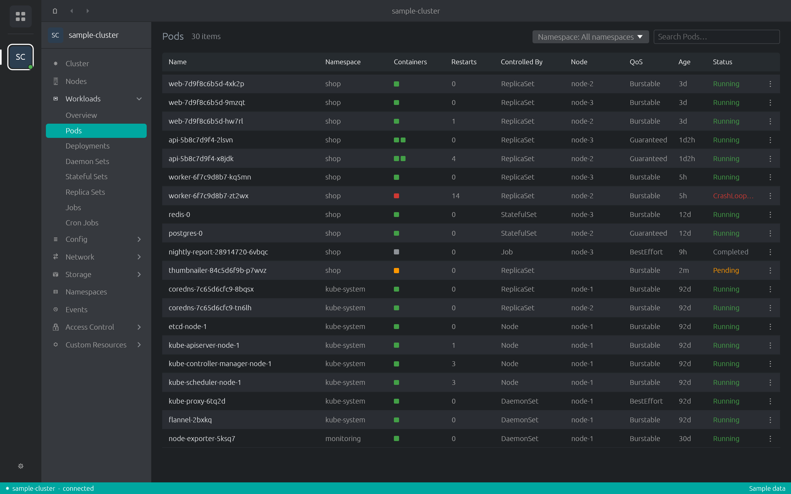

# Cluster Desk

A fast desktop Kubernetes UI written in Rust ([egui](https://github.com/emilk/egui)), modelled on the
look and behaviour of the Lens family of IDEs (FreeLens).



## Features

- Clusters from your kubeconfig (plus a built-in sample cluster to try things without one)
- Cluster overview, workloads overview, every built-in resource type and **all custom resources**
  (grouped by API group, with each definition's own columns)
- Details drawer, YAML edit, delete, scale, restart
- Pod logs with ANSI colours and search; a real terminal into pods (`kubectl exec -it`)
- Node CPU/memory usage from metrics-server, volume usage from kubelet stats
- Ingress links that open in the browser
- Preferences: kubectl matching each cluster's version (downloaded and checked against pinned
  checksums), Helm, kubeconfig files, PATH for credential plugins (OIDC/kubelogin, cloud CLIs),
  sign-in test and interactive sign-in terminal, HTTP proxy, terminal options

## Build

```sh
cargo build --release
./target/release/kubelens
```

On Linux you need `pkg-config` and the fontconfig development package
(`libfontconfig1-dev` / `fontconfig-devel`). Requires `kubectl` (or let the app download it).

`kubelens --screenshot out.png` renders the sample cluster off-screen and saves a picture
(used by CI and tests).

## Releases

Every commit to `main` builds a release:

- GitHub: `.github/workflows/release.yml` builds Linux x86_64, Windows x86_64 and macOS
  (universal: Apple Silicon + Intel) packages and creates a GitHub release. Pull requests build
  the same packages without releasing.
- GitLab: `.gitlab-ci.yml` builds Linux x86_64 only (uploads to the project's package registry and
  creates a release)

The macOS binary is not signed. After unpacking, run `xattr -d com.apple.quarantine cluster-desk`
once, or right-click it in Finder and choose Open.

## Notes

`MECHANICS.md` documents which behaviours, colours and values follow FreeLens and where they come
from. FreeLens is MIT licensed (© Freelens Authors, © OpenLens Authors); the pinned kubectl
checksum table (`src/kubectl_checksums.rs`) is taken from it.
