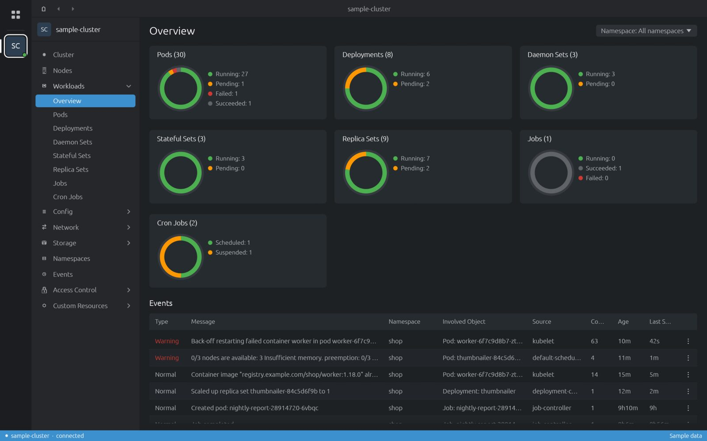
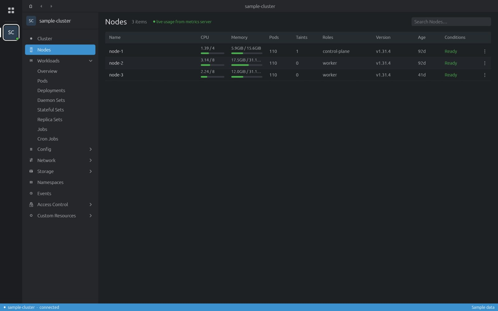
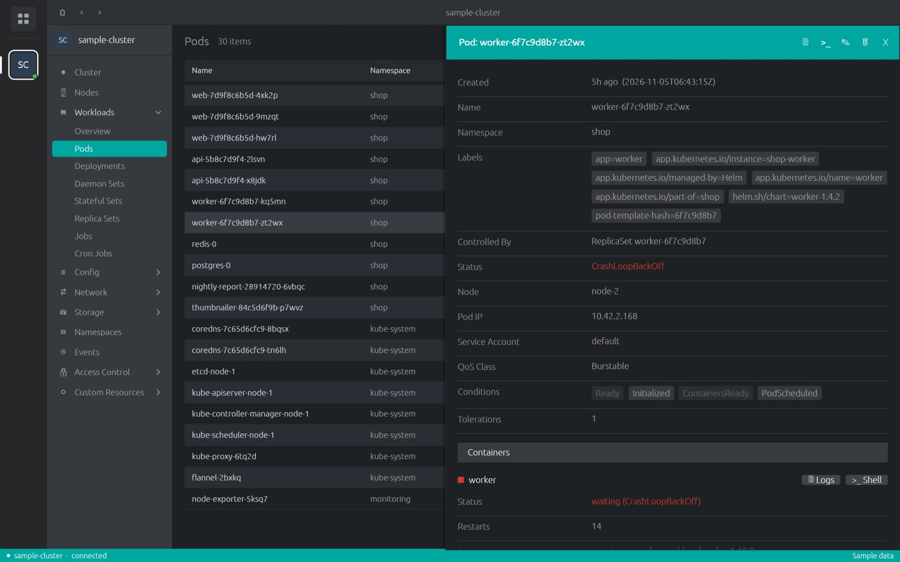
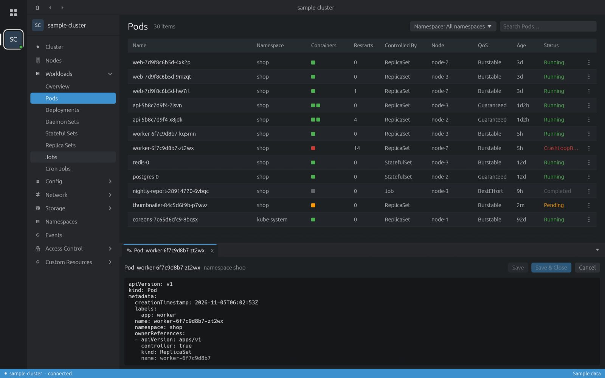
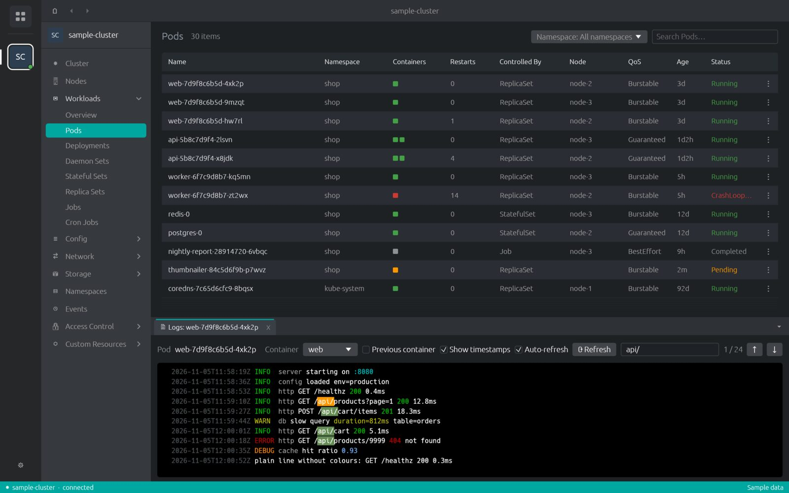
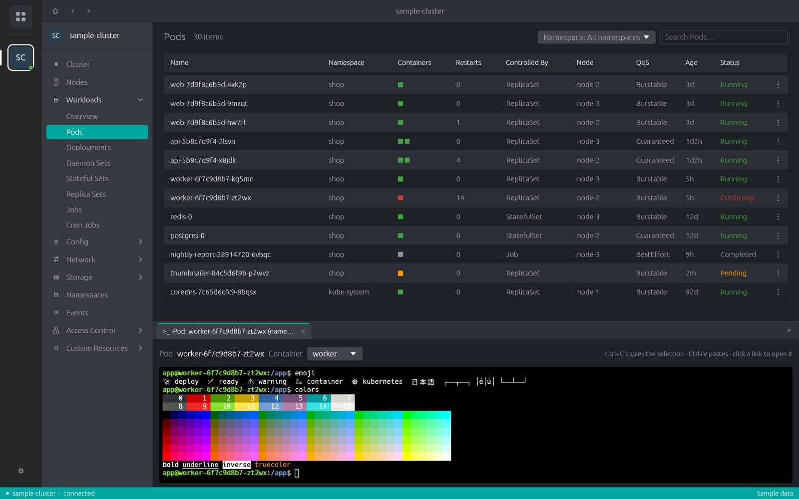
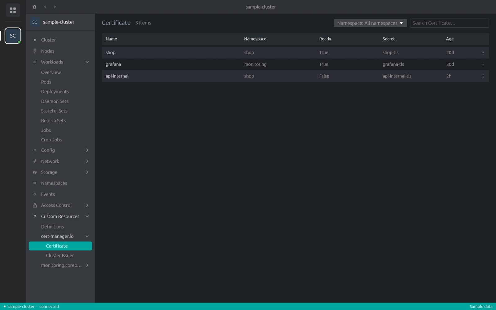

# Guide

How to get around a cluster: lists, details, edits, logs and shells.

## The window

| Area | What it holds |
|---|---|
| Hotbar (far left) | The Catalog button on top, then one icon per opened cluster. The gear at the bottom opens Preferences. |
| Sidebar | Resource groups of the current cluster: Cluster, Nodes, Workloads, Config, Network, Storage, Namespaces, Events, Access Control, Custom Resources. |
| Main area | The list or overview you picked. Back and forward arrows sit in the top bar. |
| Dock (bottom) | Tabs for logs, shells and YAML editors. Several can be open at once. |
| Status bar | The cluster and its connection state. Shows a notice when an update is ready. |

## Overviews

**Cluster** shows CPU, memory and pod rings (usage, requests, limits, allocatable, capacity) and the
current warning events. **Workloads → Overview** shows the state of pods, deployments, daemon sets,
stateful sets, replica sets, jobs and cron jobs, followed by recent events.

## Resource lists

- Pick a namespace from the *Namespace* menu, or keep *All namespaces*.
- Type in the search box to filter rows.
- Click a column header to sort.
- The <kbd>⋮</kbd> menu at the end of a row has the actions for that object.

Lists refresh by themselves. Nodes show live CPU and memory bars from metrics-server, every 30 seconds:
the bright part is usage, the faded part is requests. Without metrics-server the bars read `N/A`.

## Details drawer

Click a row to open its details on the right: metadata, labels, status, conditions, and the parts that
matter for the kind (containers for pods, rules for ingresses, and so on). <kbd>Esc</kbd> closes it.

The drawer's title bar has the actions:

| Action | Available for |
|---|---|
| Edit | Every kind. Opens the YAML in the dock. |
| Delete | Every kind, after a confirmation. |
| Scale | Deployments, stateful sets, replica sets. |
| Restart | Deployments, stateful sets, daemon sets. Pods are replaced one by one. |
| Logs, Shell | Pods, per container. |
| Open in browser | Ingresses with a host. |

## Editing YAML

Edit opens the object in a dock tab. *Save* applies it and keeps the tab open; *Save & Close* applies
and closes; *Cancel* drops the changes. Unsaved edits show ● modified.

## Pod logs

- Pick the *Container*, or tick *Previous container* to read the log of the last crashed run.
- *Show timestamps* and *Auto-refresh* (every 10 seconds) are toggles.
- Type in the search box: matches are highlighted. <kbd>Enter</kbd> or the arrows jump between them.
- ANSI colours in the log are kept.

## Pod shell

Shell runs `kubectl exec -it` into the chosen container, in a real terminal: colours, Unicode, mouse
selection and links.

| Keys | Does |
|---|---|
| <kbd>Ctrl</kbd>+<kbd>C</kbd> | Copies when text is selected; otherwise interrupts, as usual. |
| <kbd>Ctrl</kbd>+<kbd>V</kbd> | Pastes. |
| Click a link | Opens it in your browser. |

Font size and copy-on-select live in [Preferences → Terminal](preferences.md#terminal).

## Custom resources

**Custom Resources** lists every CRD in the cluster, grouped by API group (`cert-manager.io`,
`monitoring.coreos.com`, …). Each list uses the columns its definition declares
(`additionalPrinterColumns`). *Definitions* lists the CRDs themselves.

