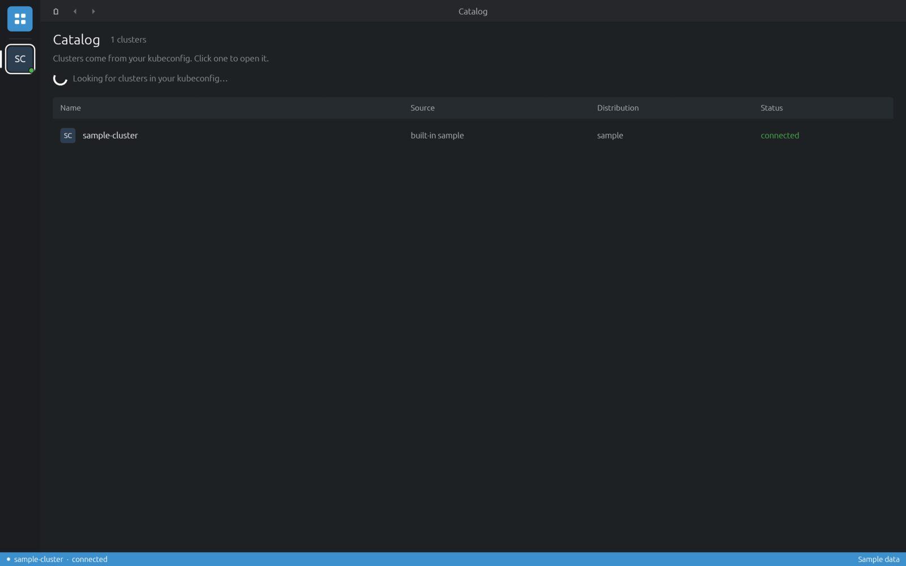

# Install

Download the package for your system from the
[latest release](https://github.com/DiverOfDark/cluster-desk/releases/latest), then follow the steps below.

| System | Package |
|---|---|
| Linux x86_64 | [`cluster-desk-linux-x86_64.AppImage`](https://github.com/DiverOfDark/cluster-desk/releases/latest/download/cluster-desk-linux-x86_64.AppImage) |
| Windows x86_64 | [`cluster-desk-windows-x86_64.zip`](https://github.com/DiverOfDark/cluster-desk/releases/latest/download/cluster-desk-windows-x86_64.zip) |
| macOS 11+ (Apple Silicon and Intel) | [`cluster-desk-macos-universal.dmg`](https://github.com/DiverOfDark/cluster-desk/releases/latest/download/cluster-desk-macos-universal.dmg) |

## Linux

```sh
chmod +x cluster-desk-linux-x86_64.AppImage
./cluster-desk-linux-x86_64.AppImage
```

The AppImage is built on Ubuntu 22.04, so it runs on distributions with that glibc or newer.
Keep the file somewhere permanent (for example `~/Applications`): updates replace this file in place.

## Windows

1. Unzip `cluster-desk-windows-x86_64.zip` to a folder you keep, for example `%LOCALAPPDATA%\Programs\Cluster Desk`.
2. Run `cluster-desk.exe`. If SmartScreen warns about an unknown publisher, choose *More info → Run anyway*.

## macOS

1. Open the dmg and drag **Cluster Desk** to **Applications**.
2. The app is not signed with an Apple developer certificate, so macOS blocks the first launch. Allow it once:

   ```sh
   xattr -dr com.apple.quarantine "/Applications/Cluster Desk.app"
   ```

   Or open it, then choose *System Settings → Privacy & Security → Open Anyway*.

## First run

The app opens on the **Catalog**: every context in your kubeconfig (`KUBECONFIG`, or `~/.kube/config`),
plus a built-in `sample-cluster`. Click a cluster to open it.



*The Catalog. Clusters appear in the left-hand hotbar once opened.*

### kubectl

You don't need kubectl installed. Cluster Desk downloads the kubectl that matches each cluster's version
from `dl.k8s.io`, checks it against a pinned checksum, and keeps it in `~/.local/share/cluster-desk/binaries`.
With downloads turned off it uses the kubectl on your `PATH` or the path you set.
See [Preferences → Kubernetes](preferences.md#kubernetes).

> [!TIP]
> **Started from a desktop launcher?** Launchers often don't see the `PATH` your shell has, so sign-in
> plugins like `kubelogin`, `aws` or `gke-gcloud-auth-plugin` may not be found. Add their folders under
> [Preferences → Authentication](preferences.md#authentication).

## Updates

Release builds update themselves. This is on by default; turn it off under *Preferences → Updates*.

1. Every 6 hours the app reads `latest.json` from the newest GitHub release.
2. A newer package downloads in the background and is checked against the
   [minisign](https://jedisct1.github.io/minisign/) public key built into the app. Anything else is refused.
3. The update installs when you quit the app. To install it now, click the update notice in the status bar
   (it opens *Preferences → Updates*), then *Restart to update*.

What gets replaced: the AppImage file on Linux, `cluster-desk.exe` on Windows, `Cluster Desk.app` on macOS.
Copies built with plain `cargo build` don't update.
