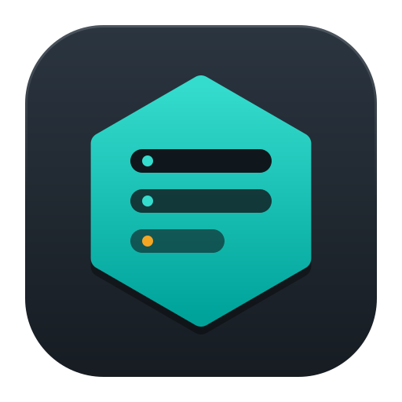
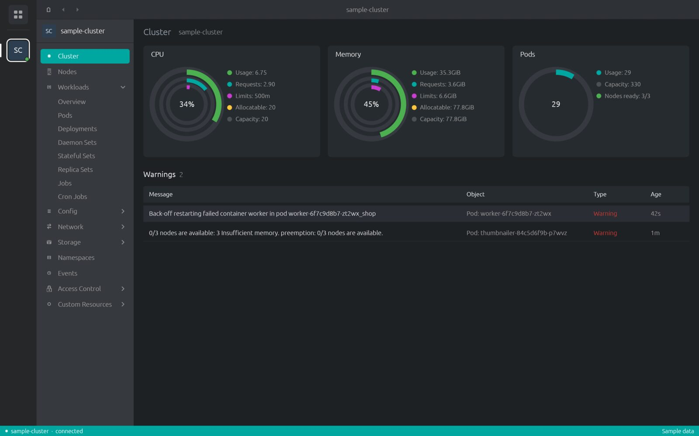
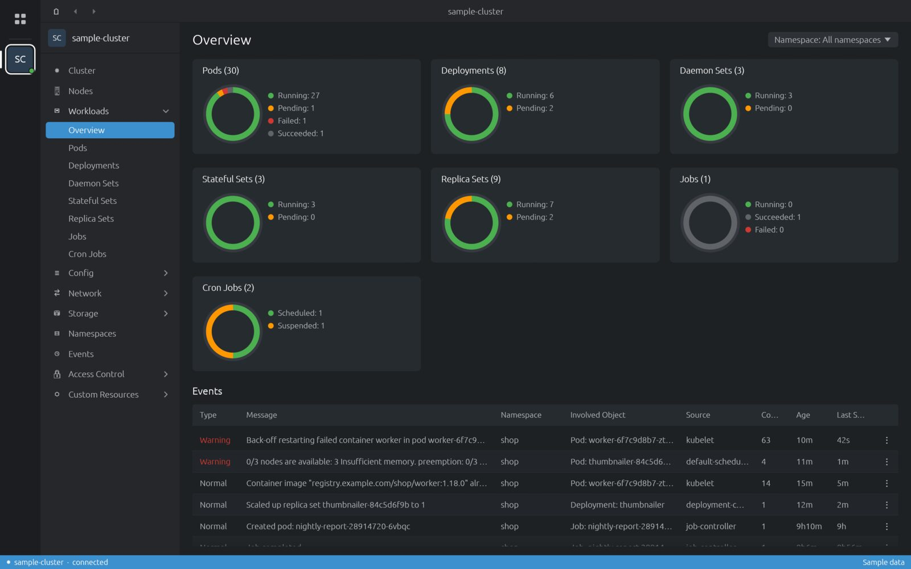
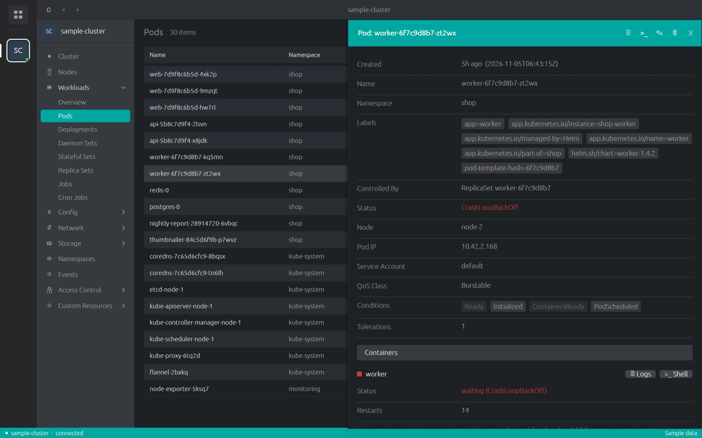
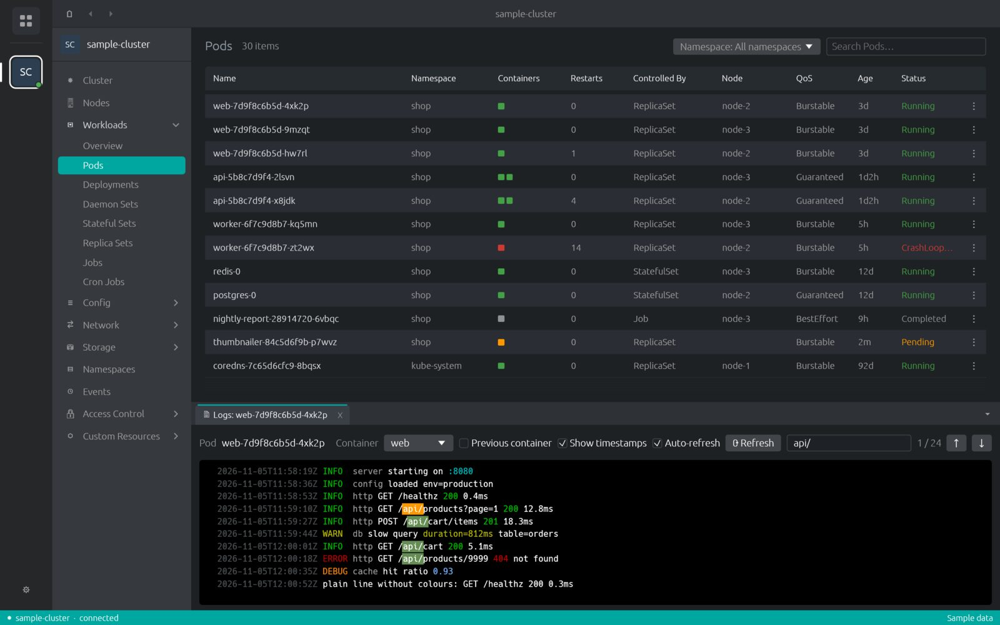
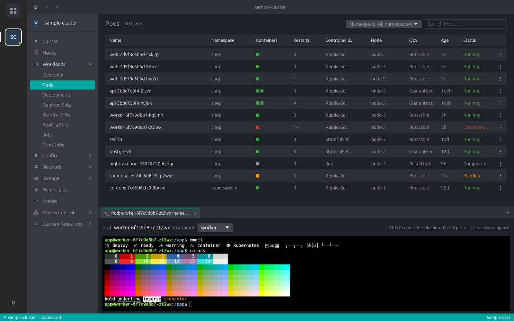
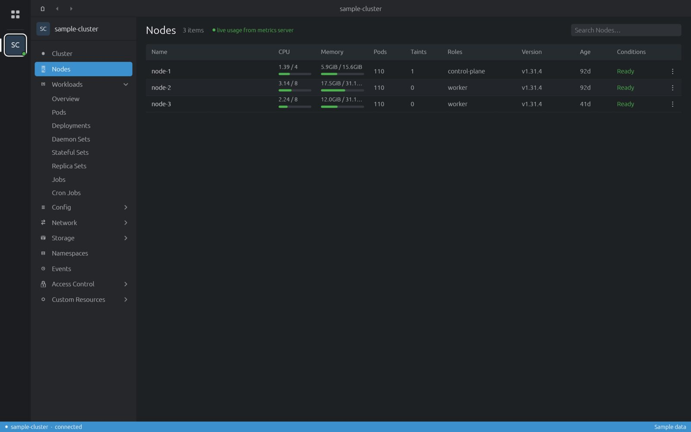
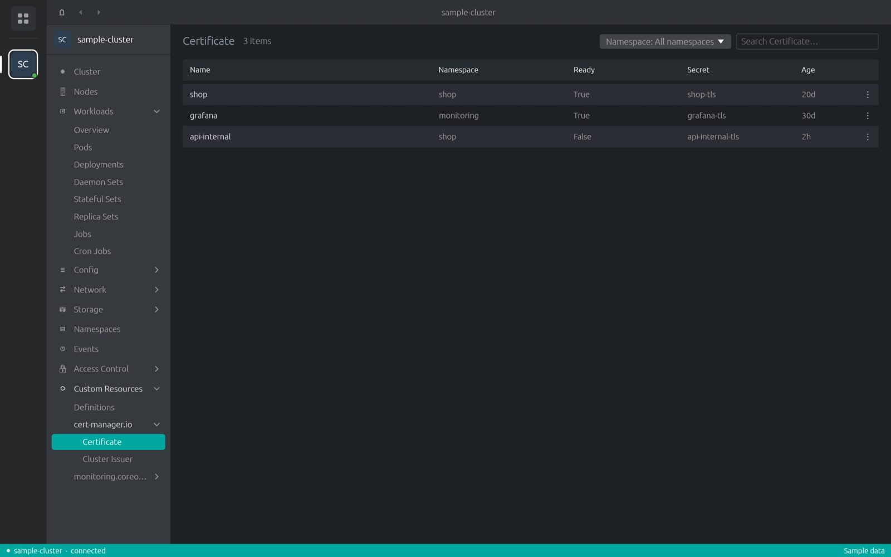

<h1>Cluster Desk</h1>

A fast desktop Kubernetes UI. One native binary written in Rust, no browser engine inside.
Laid out like the Lens family of IDEs, so it feels familiar from the first click.

<a class="btn primary" href="https://github.com/DiverOfDark/cluster-desk/releases/latest/download/cluster-desk-linux-x86_64.AppImage">Linux<small>AppImage · x86_64</small></a>
<a class="btn" href="https://github.com/DiverOfDark/cluster-desk/releases/latest/download/cluster-desk-windows-x86_64.zip">Windows<small>zip · x86_64</small></a>
<a class="btn" href="https://github.com/DiverOfDark/cluster-desk/releases/latest/download/cluster-desk-macos-universal.dmg">macOS<small>dmg · Apple Silicon + Intel</small></a>

Latest release from <a href="https://github.com/DiverOfDark/cluster-desk/releases/latest">GitHub Releases</a>.
Installed copies update themselves. <a href="install.html">Install notes →</a>

## What it does

<h3>Every built-in kind</h3>

Cluster and workloads overviews, then pods, deployments, services, storage, RBAC and the rest, with a namespace filter and search.

<h3>Details, edit, act</h3>

A details drawer for any object. Edit its YAML, delete it, scale or restart workloads.

<h3>Logs with colours and search</h3>

ANSI colours kept, matches highlighted, previous container, timestamps, auto-refresh.

<h3>A real terminal into pods</h3>

<code>kubectl exec -it</code> in a full terminal: colours, Unicode, copy and paste.

<h3>Live usage</h3>

Node CPU and memory from metrics-server, volume usage from kubelet stats.

<h3>All custom resources</h3>

Every CRD in the cluster, grouped by API group, each list showing that definition's own columns.

## Sign-in that works

Cluster Desk reads your kubeconfig and runs the kubectl that matches each cluster's version,
downloaded on demand and checked against pinned checksums. OIDC (kubelogin), EKS, GKE, AKS,
DigitalOcean, Oracle Cloud and Teleport sign-in plugins work. Preferences shows how each cluster
signs in and opens a terminal for sign-ins that ask questions. [More →](preferences.md#authentication)

## Try it without a cluster

Cluster Desk ships with a built-in **sample cluster**. Open the app and click `sample-cluster` in the
Catalog to look around. Every screenshot in these docs is that sample cluster.
